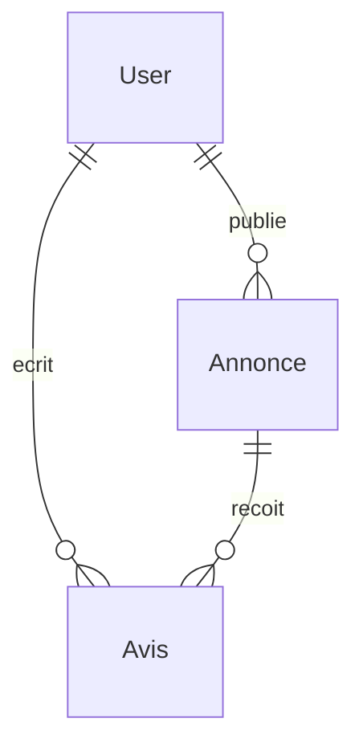

# PolyClub

Application web du **club informatique** de l'École Polytechnique de Sousse.
Les visiteurs lisent les annonces et les avis. Un membre connecté peut publier une annonce, laisser un avis, et supprimer uniquement ce qu'il a écrit.

**Auteur :** Mohamed Yassine Mokni  
**Enseignant :** Dr. Abdelweheb Gueddes  
**Année :** 2025–2026  
**Stack :** MongoDB, Express, React 18, Node.js, JWT

## Les 3 modèles

| Modèle | Rôle | Relation |
| --- | --- | --- |
| `User` | Membre : nom, email, mot de passe haché | Un membre publie plusieurs annonces et plusieurs avis |
| `Annonce` | Annonce du club : titre, contenu, date, auteur | Plusieurs avis pour une annonce |
| `Avis` | Message d'un membre sur une annonce | Lié à une annonce et à un auteur |

La relation est **One-to-Many** par référence `ObjectId` + `ref`.
Le nom de l'auteur affiché à l'écran vient de `.populate()`, pas d'un nom copié dans l'annonce.



## API

| Méthode | Route | Accès | Rôle |
| --- | --- | --- | --- |
| POST | `/api/auth/register` | Public | Inscription, mot de passe haché avec bcrypt |
| POST | `/api/auth/login` | Public | Connexion, retourne un JWT |
| GET | `/api/annonces` | Public | Liste des annonces, auteur peuplé |
| GET | `/api/annonces/:id` | Public | Détail + avis, auteurs peuplés |
| POST | `/api/annonces` | JWT | Créer une annonce |
| DELETE | `/api/annonces/:id` | JWT + auteur | Supprimer son annonce et ses avis |
| POST | `/api/annonces/:id/avis` | JWT | Ajouter un avis |
| DELETE | `/api/avis/:id` | JWT + auteur | Supprimer son avis |

Le middleware `protect` lit le header `Authorization: Bearer <token>`.
Sans token valide, l'ajout et la suppression répondent `401`.

## Lancer en local

Prérequis : Node.js 18+ et une base MongoDB (locale ou Atlas).

```bash
cd server
cp .env.example .env
# Remplir MONGO_URI, JWT_SECRET et CLIENT_URL
npm install
npm run dev
```

```bash
cd client
cp .env.example .env
npm install
npm run dev
```

Front : http://localhost:5173  
API : http://localhost:5000 (ou le `PORT` du fichier `.env`)

Sur Mac, le port 5000 est souvent déjà pris par AirPlay. Dans ce cas, mets `PORT=5001` dans `server/.env` et `VITE_API_URL=http://localhost:5001` dans `client/.env`.

## Déploiement

Le fichier `.env` ne va pas sur Git. Les secrets se mettent dans les dashboards.

1. **MongoDB Atlas** : cluster gratuit M0, base `polyclub`, utilisateur base de données, Network Access `0.0.0.0/0` (pour que Render puisse se connecter). Copier l'URI.
2. **Render** : New Web Service, dossier racine `server`, build `npm install`, start `npm start`.
   Variables : `MONGO_URI`, `JWT_SECRET`, `CLIENT_URL` (l'URL Vercel, sans `/` à la fin).
3. **Vercel** : importer le dépôt, dossier racine `client`.
   Variable : `VITE_API_URL` = l'URL Render (sans `/` à la fin).
   Vite lit cette variable **au moment du build**. Après l'avoir ajoutée, relancer un déploiement.

`VITE_` est obligatoire : Vite n'expose au navigateur que les variables qui commencent ainsi.

## Paquets et à quoi ils servent

**Serveur**

- `express` : routes HTTP
- `mongoose` : modèles et requêtes MongoDB
- `bcryptjs` : algorithme bcrypt, version JavaScript (pas de compilation C++)
- `jsonwebtoken` : créer et vérifier le JWT
- `cors` : autoriser le front Vercel à appeler l'API
- `dotenv` : lire le fichier `.env`

**Client**

- `react` / `react-dom` : interface
- `vite` : outil de développement et build
- `axios` : appels HTTP, avec un intercepteur qui ajoute le token

Le front n'utilise pas de routeur. La page affichée est un état React (`accueil`, `login`, `register`, `detail`), ce qui garde une seule page HTML.
